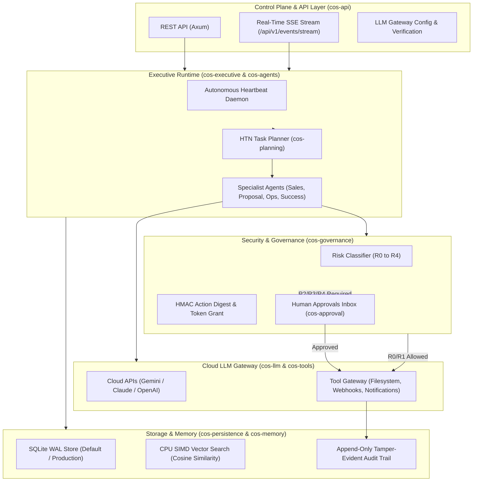

# Viraj Verse

> **Autonomous Company Operating System**  
> An enterprise-grade, memory-driven autonomous agent runtime built in pure Rust. Runs entirely on CPU with zero GPU requirement, formal R0–R4 governance, tamper-evident audit logs, dynamic Goal Forest orchestration, and hybrid SQLite WAL / vector persistence.

[](https://www.rust-lang.org/)
[](LICENSE)
[-brightgreen.svg?style=flat-square)](Cargo.toml)
[](crates/)

---

## Overview

**Viraj Verse** is an autonomous operating system designed to run complex company operations — from lead qualification and client discovery to project planning and autonomous delivery — under strict cryptographic governance and human supervisory control.

Unlike typical script-heavy or mock-driven agent frameworks, Viraj Verse is built from the ground up as a **deterministic, compiled Rust platform**:
- **Zero Hardcoded Business Copy:** All guidelines, sales policies, templates, and operational rules live dynamically inside scoped, versioned memory records. Code contains only domain engines and invariant validation.
- **Pure CPU Footprint:** LLM inference and embedding vectors are consumed via cloud APIs (or local HTTP endpoints). Vector similarity lookup runs locally on CPU using SIMD cosine similarity. **Zero dedicated GPU hardware required.**
- **R0–R4 Governance Guardrails:** Autonomous actions are classified by risk tier. High-impact operations (code execution, financial transactions, external communications) strictly require cryptographic token grants and human approvals.
- **Embedded Hybrid Persistence:** High-concurrency Write-Ahead Logging (WAL) SQLite engine running out-of-the-box with zero database installation, with pluggable abstractions for multi-node PostgreSQL clusters.
- **Dynamic Goal Forest:** Hierarchical Goal DAG with automated cycle prevention, progress rollups, and Hierarchical Task Network (HTN) execution trees.

---

## System Architecture



---

## Modular Crates

The codebase is organized into **20 clean, decoupled crates** with strict boundaries and zero circular dependencies:

| Crate | Purpose |
| :--- | :--- |
| `cos-domain` | Core UUIDv7 identifiers, status lifecycles, and risk classification primitives |
| `cos-identity` | Cryptographic identities (`ActorIdentity`, `System`, `Agent`, `Founder`, `HumanSupervisor`) |
| `cos-contracts` | Action manifests, HMAC SHA-256 action digests, and cryptographically signed task grants |
| `cos-governance` | R0–R4 authority boundaries, client isolation enforcement, and token verification |
| `cos-approval` | Multi-tiered human-in-the-loop approval workflows, expiration timers, and audit linkages |
| `cos-audit` | Append-only, tamper-evident audit ledger tracking every action, decision, and payload hash |
| `cos-memory` | Scoped dynamic memory (`Company`, `Client`, `Task`, `AgentWorking`) with CPU vector search |
| `cos-knowledge` | Epistemic provenance tracking, evidence confidence scoring, and automated rule promotion |
| `cos-goals` | Hierarchical Goal Forest with DAG validation, cycle detection, and progress propagation |
| `cos-planning` | Hierarchical Task Network (HTN) decomposition and memory-driven procedure dispatch |
| `cos-agents` | Dynamic specialist agent execution engine and memory-guided reasoning loops |
| `cos-tools` | Idempotent execution gateway for sandboxed filesystem, webhooks, and notifications |
| `cos-outcomes` | Outcome registration, KPI verification, and feedback loop evaluation |
| `cos-learning` | Dynamic policy tuning, outcome-driven confidence adjustments, and template refinement |
| `cos-llm` | Vendor-agnostic LLM client port (Gemini, OpenAI, Claude, Ollama) and dynamic model discovery |
| `cos-persistence` | Unified storage engine supporting embedded SQLite (WAL mode) and file-based JSON stores |
| `cos-config` | Operational system settings and governance parameter validation |
| `cos-executive` | Central company orchestrator, heartbeat loop, and autonomous goal scheduler |
| `cos-api` | Axum-powered HTTP server, REST endpoints, and real-time Server-Sent Events (SSE) stream |
| `cos-node` | Top-level runtime entrypoint, service bootstrapping, and graceful shutdown daemon |

---

## Governance & Risk Classification (R0–R4)

Every single autonomous action proposed by an agent must be classified into a formal risk tier before execution:

- **R0 (Read-Only / Autonomous):** Read internal memory, query system status, retrieve telemetry. Dispatched immediately without approval.
- **R1 (Reversible Low-Impact):** Draft proposals, stage scratch deliverables, emit internal notifications. Dispatched automatically with audit logging.
- **R2 (Reversible Medium-Impact):** Customer communications, public deliverables, external draft dispatch. Auto-dispatched only when authorized by company memory policy.
- **R3 (Irreversible High-Impact):** Modifying production deliverables, invoking external paid APIs, webhook mutations. Strictly requires Supervisor or Founder approval.
- **R4 (Existential Impact):** Company credential alterations, bank/payment dispatches, policy rewrite, contract finalization. **Strictly requires Founder cryptographic approval.**

---

## Quick Start

### 1. Prerequisites
- [Rust](https://www.rust-lang.org/tools/install) (version 1.80 or later recommended).
- Windows, macOS, or Linux. (Pure CPU native build, no C++ toolchain or CUDA required).

### 2. Configuration
Copy the sample environment file:
```bash
cp .env.example .env
```

Set your cloud LLM API key (e.g. Gemini, OpenAI, Claude):
```env
COS_STORAGE_BACKEND=sqlite
COS_DATA_DIR=./data
COS_LLM_PROVIDER=gemini
COS_LLM_BASE_URL=https://generativelanguage.googleapis.com
COS_LLM_API_KEY=your_gemini_api_key
COS_LLM_MODEL=gemini-2.0-flash
```

### 3. Build & Run
Run the node in development mode:
```bash
cargo run -p cos-node
```

The system will start with SQLite in WAL mode and bind the API service to `http://127.0.0.1:8008`:
```
--------------------------------------------------
Viraj Verse - Autonomous Company Operating System
Architecture: Memory-Driven, Zero-Hardcoded Copy
Security: R0-R4 Governance & Strict Human Approvals
Engine: Autonomous Heartbeat Daemon + Real-time SSE
--------------------------------------------------
Initializing storage engine (backend: sqlite) at: ./data
COS REST & Gateway API listening on http://127.0.0.1:8008
- Gateway Config:      GET/PUT /api/v1/gateway/config
- Verify Connection:   POST    /api/v1/gateway/verify-connection
- Model Discovery:     GET     /api/v1/gateway/discover-models
- Real-time Stream:    GET     /api/v1/events/stream
- Approvals Inbox:     GET     /api/v1/approvals
- Goal Forest:         GET/POST/api/v1/goals
- Audit Stream:        GET     /api/v1/audit
```

### 4. Running the Test Suite
Viraj Verse includes **58 comprehensive test suites** covering **1,260+ deterministic stress scenarios**, DAG cycle prevention, and concurrency race matrices:
```bash
cargo test --workspace
```

Run code formatting and strict clippy linter:
```bash
cargo fmt --all -- --check
cargo clippy --workspace --all-targets -- -D warnings
```

---

## REST & Event Stream API Reference

| Endpoint | Method | Description |
| :--- | :---: | :--- |
| `/api/v1/health` | `GET` | Health check and system uptime status |
| `/api/v1/events/stream` | `GET` | Real-time Server-Sent Events (SSE) stream for UI dashboards |
| `/api/v1/gateway/config` | `GET` | Retrieve LLM gateway configuration (API keys masked) |
| `/api/v1/gateway/config` | `PUT` | Update runtime gateway endpoints and active models |
| `/api/v1/gateway/verify-connection` | `POST` | Live latency check and provider endpoint verification |
| `/api/v1/gateway/discover-models` | `GET` | Dynamically list available models on connected gateway |
| `/api/v1/goals` | `GET` | Retrieve full hierarchical Goal Forest DAG |
| `/api/v1/goals` | `POST` | Create or link a new business goal with subgoals and weights |
| `/api/v1/approvals` | `GET` | List pending human approval requests waiting for review |
| `/api/v1/approvals/:id/decide` | `POST` | Approve or reject a pending request (`{"decision": "Approved"}`) |
| `/api/v1/audit` | `GET` | Paginated append-only immutable audit trail with event hashes |

---

## Security Invariants

1. **HMAC Action Manifest:** Any task execution request is hashed into a deterministic `ActionDigest`. If a task parameter is tampered with between planning and execution, execution is immediately denied.
2. **Ephemeral Scoped Grants:** Task grants are cryptographically bound to specific actor IDs, capabilities, max invocation counts, and expiration deadlines. Replaying or reusing tokens fails immediately.
3. **Multi-Tenant Client Isolation:** Client memory records are strictly compartmentalized. An agent operating on behalf of Client A cannot access or query namespaces belonging to Client B.
4. **Zero ReDoS Risks:** No regular expression libraries are utilized across the engine; all parsing is performed via native Rust bounds-checked string processing.

---

## License

This project is licensed under either of:
- Apache License, Version 2.0 ([LICENSE-APACHE](LICENSE-APACHE) or http://www.apache.org/licenses/LICENSE-2.0)
- MIT License ([LICENSE-MIT](LICENSE-MIT) or http://opensource.org/licenses/MIT)

at your option.

---

## Author & Maintainer

**Viraj Srivastav**  
Founder & Lead Architect, Viraj Verse  
Email: [virajsrivastav1112@gmail.com](mailto:virajsrivastav1112@gmail.com)  
Website: [https://virajverse.com](https://virajverse.com)
