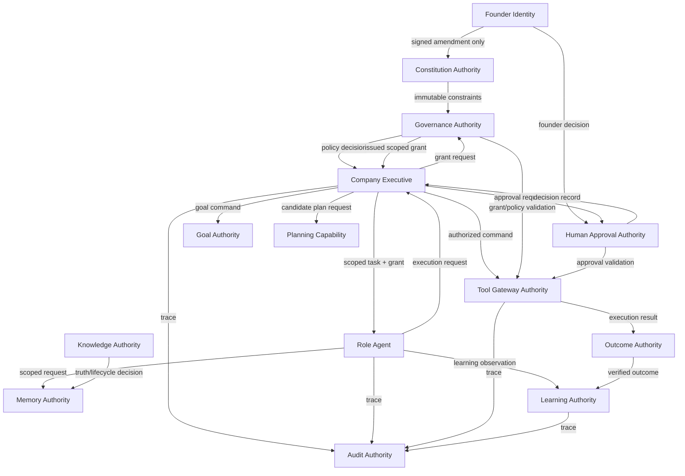
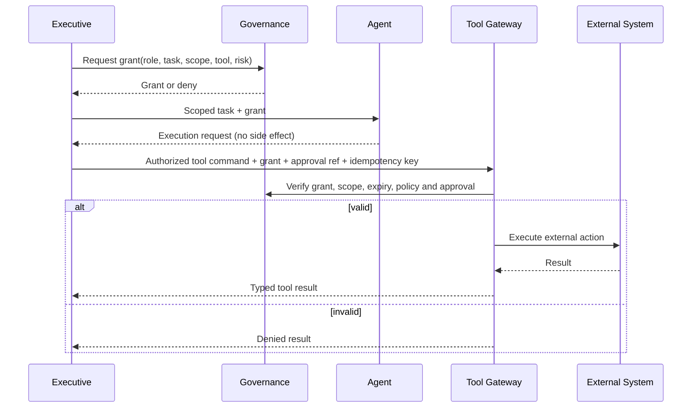
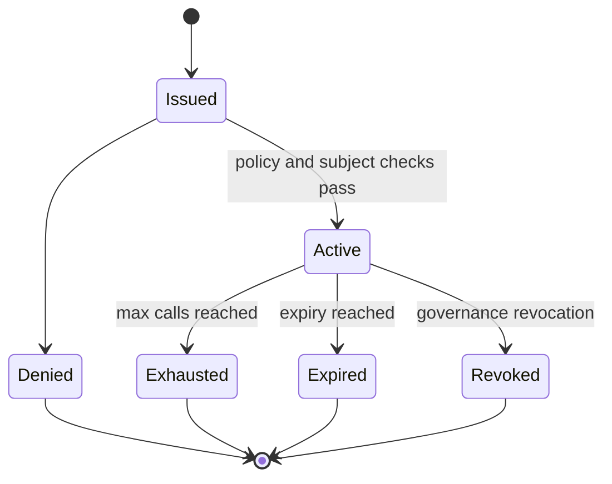
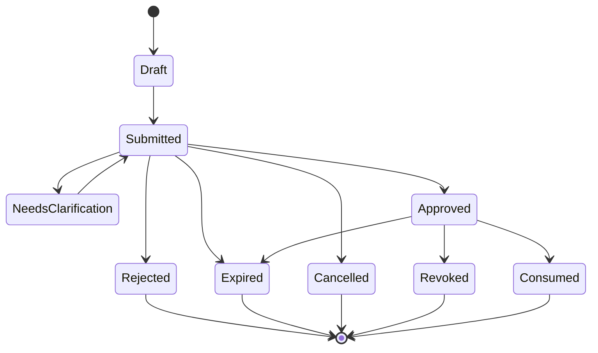
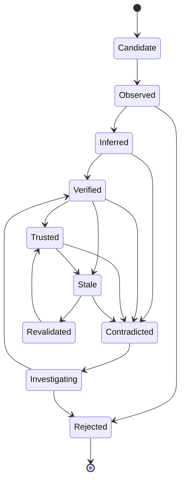
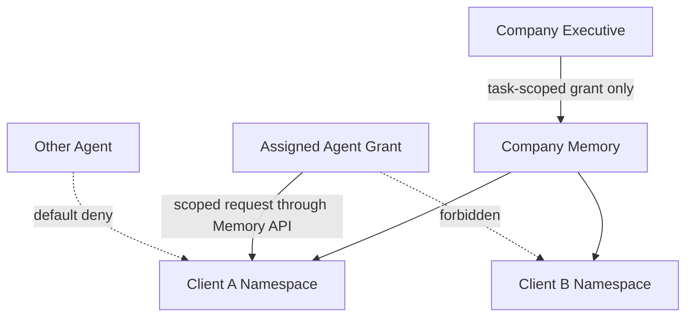

# Viraj Versenologies — Authority Boundaries and Contracts

**Status:** Design specification  
**Purpose:** Har subsystem ka ownership, permission, input/output aur escalation boundary define karna.

## 1. Fundamental laws

### Law 1 — No dual authority

Kisi state, decision ya external side effect ke liye do owners nahi honge.

### Law 2 — Suggestion is not authority

LLM, agent, planner, evaluator aur learning engine suggestion de sakte hain. Final mutation sirf owning authority karegi.

### Law 3 — Read is not write

Memory read karne se memory mutate karne ka right nahi milta.

### Law 4 — Approval is explicit

Approval request ko silence, timeout ya LLM confidence approval nahi maana jayega.

### Law 5 — Learning cannot rewrite constitution

Learning procedures, skills aur low-risk strategies ko improve kar sakti hai; governance boundary ko nahi.

### Law 6 — Every side effect is attributable

Har external side effect ke saath authenticated actor, valid grant, applicable approval **ya pre-approved policy decision**, input version, action digest, idempotency key aur audit trace mandatory hai.

## 2. Authority registry



Ye diagram authority hierarchy nahi hai. Arrows request, validation, decision ya result flow represent karte hain. Har node apne owned state ka final writer hai.

## 3. Detailed ownership matrix

| Domain object | Owner | Writers | Readers | Forbidden writer |
|---|---|---|---|---|
| Constitution rule | Constitution authority | No runtime writer; signed founder-approved amendment/migration only | All runtime modules | Agent, LLM, learning |
| Company goal | Goal service | Goal service command handler; Executive/founder are requesters | Executive, planner, agents, dashboard | Role agent directly |
| Goal priority | Goal service | Goal service command handler using executive policy input | Planner, dashboard | LLM, tool |
| Task assignment | Executive | Executive scheduler | Assigned agent, audit | Agent-to-agent direct |
| Task execution state | Executive runtime | Executive task state machine | Executive, agent, dashboard | LLM |
| Agent capability profile | Governance authority | Governance-controlled registry | Runtime, dashboard | Agent self-registration |
| Agent working memory | Memory service | Memory API after scoped request | Assigned agent, executive with grant | Other clients/agents |
| Client memory | Memory service | Memory API after scope validation | Assigned roles, executive with grant | Unscoped role/LLM |
| Company knowledge truth status | Knowledge authority | Knowledge command handler | Authorized roles | Raw prompt output |
| Company knowledge storage | Memory service | Versioned memory command | Authorized roles | Direct agent overwrite |
| Procedure/skill | Learning service | Versioned promotion workflow | Planner, roles | Direct agent overwrite |
| Approval request | Approval service | Approval command handler | Founder, executive, audit | Agent marking itself approved |
| Approval decision | Named approver or approval policy | Human decision for required risk; policy decision only where allowed | Runtime, audit | LLM, proposing agent |
| Tool grant | Governance authority | Governance grant issuer | Tool gateway, audit | Agent or Executive self-grant |
| External side effect and execution state | Tool gateway | Tool gateway transaction; adapter performs provider call | Outcome, audit | Agent direct API |
| Outcome record | Outcome service | Outcome evaluator after evidence collection | Learning, executive | Planner before execution |
| Audit event | Audit service | Append-only audit API | Authorized audit readers | Any update/delete |

## 4. Capability grant

Agent ko sirf role name ke basis par permission nahi milegi. Runtime har task ke liye short-lived capability grant banayega.



Agent kabhi Tool Gateway ko directly call nahi karega. Agent sirf `ExecutionRequest` prepare karta hai; Company Executive us request ko validate karke authorized tool command ke roop mein Tool Gateway ko bhejta hai. Tool result Executive aur Outcome evaluator ko jata hai; agent ko result sirf Executive ke through scoped context mein milta hai.

Grant ke required fields:

- `grant_id`
- `task_id`
- `agent_id`
- `subject_id`
- `role`
- `allowed_capabilities`
- `client_scope`
- `project_scope`
- `tenant_scope`
- `risk_class`
- `approval_reference`
- `action_digest`
- `policy_version`
- `grant_status`
- `issued_at`
- `expires_at`
- `max_calls`
- `issued_by`
- `audit_trace_id`
- `revocation_reference`

Ye canonical `TaskGrant` schema hai. Optional business values bhi field ke andar explicit `Option` state rakhenge; field ko omit karke meaning change nahi kiya ja sakta.

```rust
pub struct TaskGrant {
    pub grant_id: GrantId,
    pub task_id: TaskId,
    pub agent_id: AgentId,
    pub subject_id: SubjectId,
    pub role: AgentRole,
    pub allowed_capabilities: Vec<Capability>,
    pub client_scope: Option<ClientScope>,
    pub project_scope: Option<ProjectScope>,
    pub tenant_scope: TenantScope,
    pub risk_class: RiskClass,
    pub approval_reference: Option<ApprovalRef>,
    pub action_digest: ActionDigest,
    pub policy_version: PolicyVersion,
    pub grant_status: GrantStatus,
    pub issued_at: DateTime<Utc>,
    pub expires_at: DateTime<Utc>,
    pub max_calls: u32,
    pub issued_by: ActorIdentity,
    pub audit_trace_id: TraceId,
    pub revocation_reference: Option<RevocationRef>,
}
```

Grant Registry is the persisted source for this complete record. Tool Gateway validation mein grant record, current Governance policy, approval record and command action digest together validate honge; koi field kisi hidden second grant record se silently fill nahi hoga.

### Grant-to-action binding

- **Side-effecting grants (R1–R4):** ek grant exactly ek canonical `action_digest` se bound hai. `allowed_capabilities` mein sirf wahi capability hogi jo digest mein encoded hai. `max_calls` same digest ke dispatch attempts (bounded retry/reconciliation, same `idempotency_key`) ki limit hai — different payload, target ya recipient ke liye naya grant aur naya digest required hai.
- **Read-only grants (R0):** `action_digest` read scope ka digest hai — canonical capability set, client/project scope, purpose aur policy version. `allowed_capabilities` multiple read capabilities rakh sakti hai, aur `max_calls` us scope ke andar total reads ki limit hai. R0 grant kabhi write/side-effect capability include nahi karega.
- Ek grant mein read aur side-effect capabilities mix nahi hongi.

Grant lifecycle:



Tool Gateway trusted clock, current policy version, grant status and revocation state ko execution ke waqt verify karega.

## 5. Risk classes

| Risk | Example | Default execution |
|---|---|---|
| R0 — internal/read | CRM read, analytics read, draft generation | Auto with grant |
| R1 — reversible low impact | Internal task creation, approved-template reminder | Auto after policy check |
| R2 — external communication | New client message, scheduled content | Approval by default; policy may allow only named templates and scopes |
| R3 — business commitment | Quote, discount, deadline, scope promise | Exact Viraj/authorized approver decision |
| R4 — financial/legal/public irreversible | Contract, refund, payment mutation, public high-risk claim | Explicit founder approval by default; delegation only through an explicit constitutional rule |

Risk class action ko override kar sakti hai. Agent confidence risk ko reduce nahi karta.

## 6. Command and event contract

### Canonical authenticated identity

All commands, events, approvals, grants and audit records use the same identity representation:

```rust
pub struct ActorIdentity {
    pub subject_id: SubjectId,
    pub actor_category: ActorCategory,
    pub credential_ref: CredentialRef,
    pub provider_ref: AuthProviderRef,
    pub authenticated_at: DateTime<Utc>,
    pub session_ref: Option<SessionRef>,
}
```

`credential_ref` and `provider_ref` are opaque references only; raw credentials, tokens or secrets are never included in contracts. `ActorCategory` is one of `Founder`, `NamedHumanApprover`, `CompanyExecutive`, `RoleAgent`, `SystemService` or `ExternalSource`.

Credential access is capability-scoped and split into two domains: Tool Gateway/Tool Adapters may access the Tool Credential Store; provider-specific LLM adapters may access the LLM Provider Credential Store. Neither domain may access the other, and no agent, LLM prompt, command payload or persisted memory may contain raw credentials.

### Canonical tracing context

Every operation carries one shared `TraceContext`. The context is copied unchanged across derived records unless a new causal operation is created.

```rust
pub struct TraceContext {
    pub trace_id: TraceId,
    pub correlation_id: CorrelationId,
    pub causation_id: Option<CausationId>,
    pub actor: ActorIdentity,
    pub recorded_at: DateTime<Utc>,
    pub schema_version: SchemaVersion,
}
```

Mandatory rules:

| Operation | `trace_id` | `correlation_id` | `causation_id` | Actor/timestamp/schema |
|---|---|---|---|---|
| Root command or external observation | Mandatory | Mandatory; generated at intake if absent | `None` | All mandatory |
| Derived command or domain event | Mandatory | Mandatory; inherited | Mandatory reference to parent operation | All mandatory |
| Approval request | Mandatory | Mandatory | Parent task/command reference | All mandatory |
| Approval decision | Mandatory | Mandatory; inherited | Approval request reference | All mandatory |
| LLM request | Mandatory | Mandatory | Triggering task/command reference | All mandatory |
| LLM response | Mandatory; inherited from request | Mandatory; inherited | Request reference | All mandatory |
| Tool command/result | Mandatory | Mandatory | Command/tool execution reference | All mandatory |
| Learning observation/update | Mandatory | Mandatory | Outcome/experience reference | All mandatory |

`causation_id` schema field har record mein present rahega, lekin root operation ke liye explicitly `None` allowed hai. `correlation_id` business workflow ko identify karta hai; `trace_id` ek complete execution trace ko identify karta hai.

### Command

Command request hai: “kuch karna hai.” Command successful hua ya nahi, ye later event se pata chalega.

```text
CommandEnvelope {
  command_id,
  command_type,
  context: TraceContext,
  task_id,
  goal_id,
  client_scope,
  project_scope,
  payload,
  expected_version,
  capability_grant,
  approval_reference,
  action_digest,
  idempotency_key,
  created_at
}
```

### Event

Domain event successful state transition ka fact hai: “kuch ho chuka hai.” External input pehle observation/claim hota hai; verification ke baad hi trusted domain event ban sakta hai.

```text
EventEnvelope {
  event_id,
  event_type,
  aggregate_type,
  aggregate_id,
  aggregate_version,
  context: TraceContext,
  source,
  payload,
  occurred_at,
}
```

## 7. Agent contract

Agent ko is conceptual, side-effect-free interface ke through implement kiya jayega:

```text
Agent::describe() -> AgentProfile
Agent::accept(task_grant, context) -> AgentDecision
Agent::propose(task, context) -> Proposal
Agent::prepare_execution_request(approved_plan, context) -> ExecutionRequest
Agent::reflect(outcome, context) -> LearningObservation
```

Agent contract rules:

- Agent raw database connection nahi rakhega.
- Agent raw secret nahi dekhega.
- Agent approval status create/forge nahi karega.
- Agent apni memory scope ke bahar retrieve nahi karega.
- Agent direct external API call nahi karega.
- Agent approval decision ko consume kar sakta hai, create ya alter nahi.
- Agent ka execution method sirf request prepare karega; actual side effect Tool Gateway karega.
- Agent learning observation dega; skill promotion learning authority karegi.

## 8. LLM contract

```text
LlmRequest {
  request_id,
  purpose,
  bounded_context,
  instructions,
  structured_context,
  redaction_status,
  allowed_output_schema,
  prohibited_actions,
  model_policy,
  context: TraceContext,
  requested_at
}

LlmResponse {
  request_id,
  provider,
  model,
  structured_output,
  citations_or_evidence,
  uncertainty,
  token_usage,
  latency,
  raw_output_reference,
  context: TraceContext,
  completed_at
}
```

LLM response ko directly command ya event deserialize nahi kiya jayega. Pehle schema validation, policy validation aur evidence validation hogi.

## 9. Approval contract



Approval mein ye mandatory hain:

- `trace_context: TraceContext`
- Proposed action
- Exact payload/version
- Risk and impact
- Client/project scope
- Expiry
- Approver identity
- Decision time
- Reason/comment
- One-time or reusable boundary
- Exact `action_digest` and payload version
- Decision actor type: founder, named approver, or policy
- Revocation/expiry rule

Approval kisi generic “yes” response ka record nahi; exact action hash se bound decision hai.

Approval service decision ko record karta hai; decision authority alag hoti hai. R0/R1 ke liye named policy decision allowed ho sakta hai. R2 sirf explicitly named template, recipient scope, rate limit aur validity window ke andar policy se allow ho sakta hai. R3/R4 ke liye policy recommendation de sakti hai, final decision founder/named constitutional approver ka hi hoga.

### Approval binding and TOCTOU protection

`action_digest` canonicalized action type, target, scope, payload, expected aggregate version, tool capability and policy version ka digest hai. Tool Gateway execution se just pehle digest, grant status, approval status, scope, expiry aur current policy dobara verify karega. Payload, target, scope ya policy badalne par purana approval invalid hoga aur naya approval required hoga.

Consumed approval ko revoke nahi kiya ja sakta; agar external action ke baad correction chahiye to separate compensating command, new grant aur new approval process hoga.

### Idempotency contract

`idempotency_key` ka uniqueness boundary `tenant_scope + tool_name + idempotency_key` hai. Viraj Verse ke current single-company deployment mein `tenant_scope` company/organization boundary hai, client nahi; `client_scope` aur `project_scope` is boundary ke andar narrower authorization scopes hain.

Same key ke saath same canonical `action_digest` aaye to existing reservation/execution reference return kiya jayega. Same key ke saath different `action_digest` aaye to `IdempotencyConflict` reject hoga; purani execution ko nayi payload ka result nahi maana jayega.

Reservation database mein atomic unique constraint ke through hoti hai. Concurrent request winner reservation ka result wait/return karegi; loser external provider ko independently call nahi karegi.

## 10. Memory contract

Memory record ka minimum model:

```text
MemoryRecord {
  memory_id,
  namespace,
  subject_scope,
  access_policy,
  data_classification,
  retention_policy,
  redaction_status,
  kind,
  content,
  source,
  lifecycle_status,
  confidence,
  evidence_refs,
  valid_from,
  valid_until,
  version,
  created_by,
  supersedes,
  created_at,
  updated_at
}
```

Memory service owns storage and scope enforcement. Knowledge authority owns epistemic status, provenance and confidence transitions. Agent/LLM content is always a write request, never a direct database mutation.

Secrets, raw credentials, payment tokens aur unrestricted provider responses memory mein persist nahi honge. Sensitive client content encrypted storage, scope checks, retention policy aur redaction rules ke through manage hoga. Deletion request par record physically ya logically delete karne ka decision Memory service karega; audit trail mein redacted tombstone rahega.

`lifecycle_status` is an epistemic state, not a permission. A `Verified` memory still requires namespace and capability checks before retrieval or use.

Memory lifecycle:



Ye canonical knowledge lifecycle hai; conceptual documents isi state set ko use karenge. Mapping:

- Hypothesis/assumed claims `Candidate` state mein enter hote hain.
- `Unknown` memory record ka lifecycle state nahi hai; ye explicit "no record / insufficient evidence" retrieval result hai aur kabhi guessed value ya `0.0` se replace nahi hoga.
- Contradiction investigation ka "confirm" ya "revise" result `Verified` hai (revision naya superseding version banata hai); "reject" result `Rejected` hai.

## 11. Learning contract

Learning authority ko ye input milenge:

- Intended outcome
- Actual outcome
- Execution trace
- Tool result
- Human feedback
- Reuse history
- Failure and recovery history
- Existing skill version

Learning output:

- `NoChange`
- `ExperienceRecorded`
- `CandidatePattern`
- `ProcedureRevisionProposal`
- `SkillPromotionProposal`
- `PolicyAdjustmentProposal`
- `EscalationRequired`

Learning output tab tak active policy/skill nahi banega jab tak promotion gates pass na hon.

`PolicyAdjustmentProposal` bhi sirf proposal hai. Governance authority policy ko accept/reject/version karegi; R3/R4 policy changes ke liye required founder approval alag se mandatory rahega.

### Policy authority matrix

| Policy category | Proposal | Validation | Activation | Rollback |
|---|---|---|---|---|
| Immutable governance | None at runtime; founder-approved amendment process only | Governance + founder constitutional review | Signed versioned migration | Founder-approved replacement only |
| Evolvable operational | Learning service or Executive improvement proposal | Governance risk/scope checks, sandbox and outcome review | Policy Registry after required approval | Policy Registry under Governance; Executive may pause execution |
| R3/R4 operational policy | Learning/Executive proposal | Governance plus explicit founder/constitutional approver | Policy Registry after exact approval | Policy Registry plus founder/approver review |

Learning service kabhi policy ko directly active state mein write nahi karegi.

## 12. Data isolation



Company Executive ko bhi raw client content default se nahi milega; uske liye task-scoped grant aur purpose-bound retrieval required hoga. Client data cross-contamination prevention runtime policy, database query scope, audit checks aur tests sab levels par enforce hogi.

## 13. Conflict resolution contract

Conflicting records ke liye source registry, scope, validity window aur evidence quality evaluate hogi. Generic “newer wins” rule use nahi hoga.

Evaluation order:

1. Explicit current founder decision with matching scope and validity
2. Registered authoritative source with matching scope and validity
3. Newer verified evidence with stronger provenance
4. Multiple corroborated observations
5. Single reported/inferred claim
6. Unknown state

Conflict resolution result ko old evidence delete karke hide nahi kiya jayega. Old record superseded/contradicted state mein rahega.

## 14. Failure contract

Har failure classified hoga:

- `Transient`
- `PermissionDenied`
- `InvalidInput`
- `Conflict`
- `IdempotencyConflict`
- `ExternalUnavailable`
- `ToolSideEffectUnknown`
- `StrategyFailure`
- `PolicyBlocked`
- `HumanTimeout`

`ToolSideEffectUnknown` mein blind retry forbidden hai. Pehle idempotency/status reconciliation hogi.

Recovery decision bhi typed hoga:

- `RetrySameCommand`
- `RetryWithBackoff`
- `UseAlternateProcedure`
- `ReconcileExternalState`
- `Rollback`
- `PauseAndEscalate`
- `Abort`

Retry ya rollback authority Tool Gateway/Executive runtime ke defined policy ke bina agent decide nahi karega.

## 15. Identity and authorization boundary

Authentication identity establish karta hai; authorization capability grant aur policy checks se permission decide hoti hai. Dono ko mix nahi kiya jayega.

Required actor categories:

- `Founder`
- `NamedHumanApprover`
- `CompanyExecutive`
- `RoleAgent`
- `SystemService`
- `ExternalSource`

Har command, approval, grant, event aur audit record authenticated `subject_id`, actor category aur credential/provider reference carry karega. Role name identity ka replacement nahi hai.

## 16. Definition of authority-complete

Architecture tab authority-complete maana jayega jab:

- Har persisted state field ka owner documented ho
- Har owner ki authenticated identity aur mutation API documented ho
- Har external tool ka grant contract ho
- Har high-risk action approval rule se bound ho
- Har agent ka memory scope defined ho
- LLM ke direct side effects impossible hon
- Learning direct policy overwrite na kar sake
- Audit trail mein decision provenance available ho
- Grants, approvals aur policies revocable/versioned hon
- Approval exact action digest se bound ho
- Conflict, retry, rollback aur escalation states typed hon
