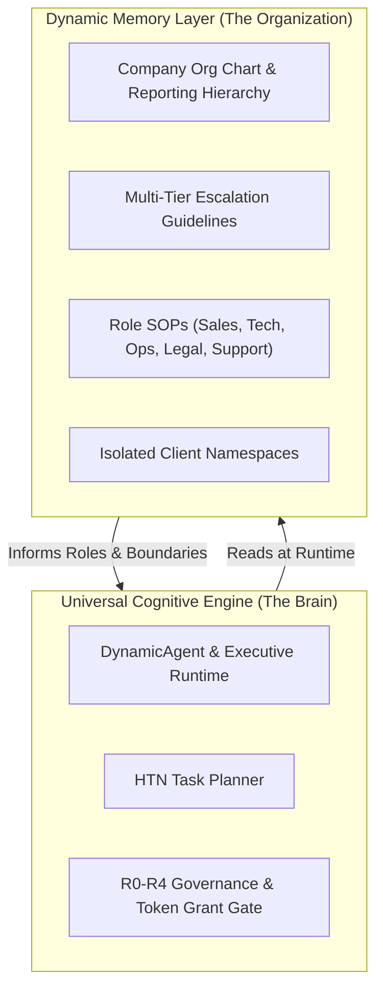
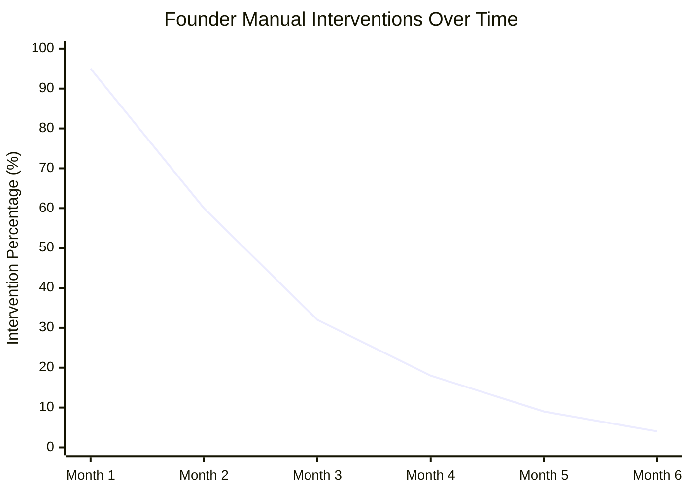

# Viraj Verse: Dynamic Memory-Driven Organization & Escalation Specification

> **Architectural Standard: Zero-Hardcoded Organizational Routing & Policy-as-Memory**  
> *Author: Viraj Srivastav / Viraj Verse Contributors*  
> *Status: Formal Specification & Architectural Blueprint*

---

## 1. Executive Philosophy: Engine vs. Memory

In traditional software and naive AI agent frameworks, organizational hierarchy, agent roles, tool links, and escalation paths are hardcoded directly into code:
```rust
// ANTI-PATTERN: Hardcoded routing & decision branches
if agent == "sales" && doubt {
    call_executive_api();
} else if agent == "coding" {
    call_cto_api();
}
```
**Viraj Verse strictly bans this pattern.**

In Viraj Verse, **the Engine is 100% universal and domain-agnostic**, while **the Organization itself is purely dynamic data stored in Memory**.



### Core Invariants:
1. **Universal Cognitive Engine:** Every specialist agent runs on the exact same high-performance, deterministic Rust execution engine (`DynamicAgent`).
2. **Memory-Driven Personas:** An agent becomes a "Sales Specialist" or a "Software Architect" solely because the Company Executive mounts a specific **Memory Namespace & Role SOP** into its context.
3. **Zero-Code Escalation:** Who an agent consults, what tools it can call, and when it must escalate to a human is defined **100% inside Memory Records**, never in compile-time code.
4. **Instant Zero-Downtime Re-organization:** If the founder changes the company's reporting structure or discount policies, it requires **0 lines of code change and 0 seconds of server downtime**. Only a `MemoryRecord` is updated.

---

## 2. The 4-Tier Autonomous Escalation Ladder

When any specialist agent encounters an ambiguity, missing policy, or high-risk decision, it follows a deterministic 4-tier chain of command resolved dynamically through memory:

```mermaid
flowchart TD
    TaskStart(["Task Dispatched to Specialist Agent"]) --> AgentEval{"Can Agent Resolve<br/>within Task Grant & Memory?"}
    
    %% Tier 1: Agent Autonomous
    AgentEval -->|Yes (R0/R1 Confident)| AgentExec["Execute Autonomous Action<br/>(Log Audit Hash)"]
    
    %% Tier 2: Executive Consultation
    AgentEval -->|Ambiguity / Policy Missing| Tier2["Tier 2: Consult Department Head / Executive<br/>(Dynamic Query via Memory Routing)"]
    Tier2 --> HeadCheck{"Does Executive Memory<br/>Contain SOP / Policy?"}
    
    HeadCheck -->|Yes| HeadGuide["Executive Issues Guidance Directive<br/>to Specialist Agent"]
    HeadGuide --> AgentExec
    
    %% Tier 3: External Research
    HeadCheck -->|No Knowledge Found| Tier3["Tier 3: Autonomous Web & Knowledge Retrieval<br/>(Query Verified Technical/Market Docs)"]
    Tier3 --> ResearchEval{"Clear, Low-Risk Solution<br/>Found & Verified?"}
    
    ResearchEval -->|Yes (High Confidence)| ResearchGuide["Format Findings as Proposed SOP<br/>Resume Execution"]
    ResearchGuide --> AgentExec
    
    %% Tier 4: Founder Signoff
    ResearchEval -->|Confusing / Risk R2-R4 / High Impact| Tier4["Tier 4: Escalate to Founder (Viraj Srivastav)<br/>(Push to Human Approvals Inbox)"]
    Tier4 --> FounderDecision{"Founder Review & Decision"}
    
    FounderDecision -->|Approve with Guidance| Learn["Write Decision into Permanent Memory<br/>(Promote to Verified Knowledge)"]
    FounderDecision -->|Reject| Abort["Cancel Task & Record Reason in Audit Log"]
    
    Learn --> AgentExec
```

### Tier Breakdown:
- **Tier 1 (Specialist Agent Domain Execution):** If the assigned task falls squarely within the agent's scoped memory guidelines and risk tier (R0/R1), it executes autonomously and records an immutable cryptographic audit event.
- **Tier 2 (Internal Executive Consultation):** If policy or procedure is incomplete, the agent queries the reporting manager specified in its `escalation_policy` memory record (typically the `CompanyExecutive`).
- **Tier 3 (External Web & Market Research):** If the internal company memory lacks the required facts (e.g., latest API syntax, market pricing benchmarks, legal terms), the Executive activates sandboxed web research tools to gather verified objective data.
- **Tier 4 (Founder Cryptographic Approval):** If the decision involves material financial consequence, contract commitment, irreversible changes (R3/R4), or policy conflict, execution **stops dead in its tracks** and delivers a structured approval proposal to the Founder's inbox.

---

## 3. Dynamic Org Chart & Escalation Data Schemas

All organizational wiring lives in standard `MemoryRecord` structures stored durably in the persistence engine (`cos-persistence`).

### A. Role Specification Schema (`Kind::Guideline`)
```json
{
  "role_id": "sales_and_lead",
  "title": "Lead Qualification & Proposal Specialist",
  "department": "commercial_operations",
  "reporting_to": "company_executive",
  "permitted_capabilities": [
    "send_notification",
    "network_http"
  ],
  "max_autonomous_risk_class": "R1_REVERSIBLE_LOW_IMPACT",
  "escalation_policy_key": "policy_commercial_escalation_v1"
}
```

### B. Escalation Policy Schema (`Kind::Procedure`)
```json
{
  "policy_key": "policy_commercial_escalation_v1",
  "rules": [
    {
      "trigger": "discount_requested",
      "conditions": {
        "max_discount_percent": 10.0
      },
      "resolution": "executive_auto_approve",
      "target_role": "company_executive"
    },
    {
      "trigger": "discount_requested",
      "conditions": {
        "min_discount_percent": 10.01
      },
      "resolution": "founder_approval_mandated",
      "target_identity": "founder"
    },
    {
      "trigger": "unknown_industry_vertical",
      "resolution": "trigger_web_research_then_founder",
      "search_query_template": "typical contract scope for {industry} software project"
    }
  ]
}
```

---

## 4. Self-Learning Loop: The Decreasing Intervention Curve

The fundamental law of the Viraj Verse operating system is **Continuous Epistemic Evolution**:

$$\text{Intervention Rate}(t) \propto \frac{1}{1 + \alpha \cdot \text{Approved Past Decisions}(t)}$$



1. **Cold Start (Month 1):** The company memory has few past verified precedents. The Founder is consulted on ~90% of business ambiguities.
2. **Knowledge Crystallization:** Every time the Founder decides *"For client type X, always charge 50% upfront"*, this guidance is signed and stored as a `MemoryRecord` with `lifecycle_status = Verified`.
3. **Autonomous Maturity (Month 3–6):** Future agents encounter identical situations, query the memory vector store in milliseconds, find the Founder's past ruling, and execute with zero human interruption.

---

## 5. Security & Isolation Safeguards

1. **Client Isolation:** Client A's escalation records and business details cannot be queried or resolved by agents operating inside Client B's namespace.
2. **Cryptographic Task Grants:** An agent cannot escalate to another agent without an HMAC-signed `TaskGrant` issued by the Executive.
3. **Tamper-Evident Audit Ledger:** Every escalation request, web search query, and Founder approval is permanently hashed with SHA-256 into the append-only audit trail (`cos-audit`).
