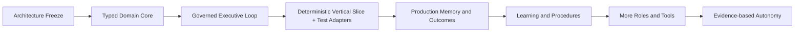
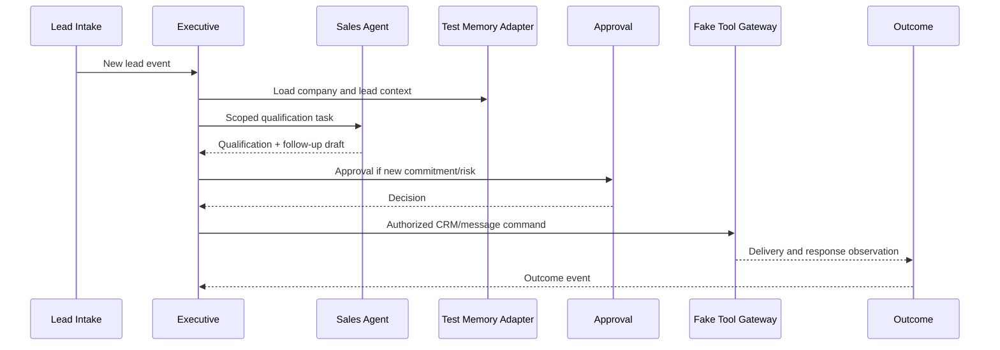
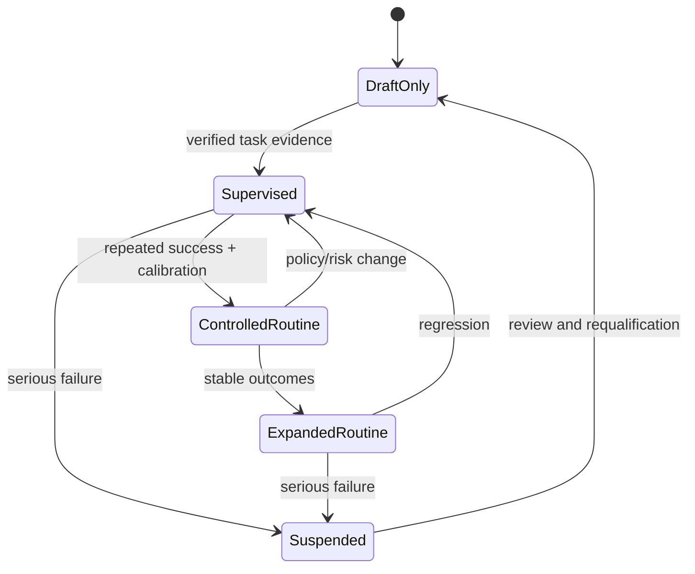

# Viraj Versenologies — Rust Implementation Roadmap and Verification Plan

**Status:** Pre-coding gate  
**Rule:** Har phase ka architecture, authority tests aur operational checks pass hone ke baad hi next phase start hoga.

## 1. Build strategy

Viraj Verse system ko ek saath “full autonomous company brain” ke roop mein build nahi kiya jayega. Pehle safe typed core, phir real workflows, phir learning aur finally governed autonomy.



## 2. Phase 0 — Architecture freeze

### Deliverables

- Master architecture approved
- Authority matrix approved
- Rust crate boundaries approved
- Command/event contracts approved
- Risk and approval classes approved
- Initial role scopes approved
- Open decisions recorded as ADRs
- Reference folder boundary documented
- Canonical role registry and Orchestrator boundary approved
- Immutable and evolvable policy categories approved
- MVP public publishing approval rule approved

### Exit criteria

- No state field without an owner
- No tool without a permission contract
- No high-impact action without approval rule
- No agent without memory and client scope
- No learning path that can mutate governance

## 3. Phase 1 — Rust foundation

### Build

- Cargo workspace
- Domain identifiers and value objects
- Error taxonomy
- Command/event envelopes
- Trace and audit identity
- Clock and ID ports
- Configuration loading without secrets leakage
- Basic persistence migration setup

### Verify

- `cargo check --workspace`
- Domain unit tests
- Serialization compatibility tests
- No domain crate dependency on provider/database crates
- Secret redaction tests

## 4. Phase 2 — Governance and authority core

### Build

- Constitution rules
- Risk classifier
- Capability grants
- Client/project scope checks
- Approval request state machine
- Append-only audit writer
- Denied-action events

### Verify

- Agent cannot self-approve
- LLM cannot issue tool command directly
- Expired grant is rejected
- Wrong client scope is rejected
- R3/R4 actions require exact approval
- Audit record exists for allow and deny
- Runtime identities cannot update or delete historical audit rows
- Audit writer permissions are append-only and tamper-evidence checks detect alteration

## 5. Phase 3 — Executive and task loop

### Build

- Event intake
- Goal-to-task decomposition
- Task assignment
- Dependency tracking
- Retry/recovery state machine
- Escalation queue
- Dashboard read model

### Verify

- Duplicate command is idempotent
- Idempotency key reservation is atomic and database-enforced
- Concurrent duplicate attempts are serialized or rejected
- Task state cannot skip forbidden transitions
- Failed task records error and recovery decision
- Executive routes only to registered role
- Escalation preserves full context and trace

## 6. Phase 4 — First vertical slice

First vertical slice: **lead intake → deterministic qualification → founder-approved follow-up**.

This phase intentionally production memory, external LLM provider ya live external integrations par depend nahi karega. Ismein deterministic Sales Agent, in-memory/SQLite test memory adapter, fake CRM/message Tool Gateway adapters aur fake clock use honge. Same typed ports aur authority checks later production adapters receive karenge.

Minimum capabilities isi slice mein build honge:

- Scoped lead/company working memory
- Provenance and confidence fields
- Deterministic qualification procedure
- Typed proposal and approval request
- Fake tool execution with atomic idempotency reservation
- Outcome record and audit event



### Verify

- Lead data has namespace and provenance
- Sales agent cannot access unrelated client namespace
- Follow-up draft is not an external action
- New commitment is blocked without approval
- Tool result is recorded as outcome
- Retry cannot send duplicate message
- Same idempotency key has one atomic reservation owner
- Crash before/after dispatch is recoverable through outbox/reconciliation tests

## 7. Phase 5 — Company and client memory

Phase 4 ke test memory ports ko production implementation se replace kiya jayega; Phase 5 first time memory architecture introduce nahi karta.

### Build

- Company knowledge namespace
- Per-client namespace
- Working memory
- Experience records
- Provenance and confidence
- Version/supersession
- Retrieval interface
- Stale and contradiction flags

### Verify

- Client A data never appears in Client B context
- Retrieved candidate knowledge is not treated as verified automatically
- Old memory remains auditable after supersession
- Memory update requires owner command
- Unknown state remains explicit
- Retention, encryption, redaction and client deletion behavior are tested

## 8. Phase 6 — LLM capability

### Build

- Provider-neutral `LlmPort`
- Structured request/response schema
- Output validation
- Citation/evidence attachment
- Cost/latency metrics
- Provider failure normalization
- Fallback and escalation policy

### Verify

- Malformed LLM output is rejected
- Unsupported claim is not promoted to company truth
- LLM cannot access secrets
- LLM cannot invoke tool without runtime command/grant
- Provider swap does not change business authority logic
- Agents depend only on provider-neutral `LlmPort`; provider SDKs remain outside agent and executive authority logic

## 9. Phase 7 — Outcomes, reflection and learning

### Build

- Intended vs actual outcome comparison
- Prediction calibration
- Failure classification
- Experience consolidation
- Pattern candidate generation
- Procedure revision proposals
- Skill promotion gates
- Rollback/version history

### Verify

- One successful result does not auto-promote a skill
- Repeated verified success can create a candidate promotion
- Promotion has scope and failure boundaries
- Failed procedure is not silently reused
- Learning cannot edit constitution or grants
- Learning cannot activate any policy directly; Governance/Policy Registry controls activation
- Rejected learning proposal remains auditable

## 10. Phase 8 — Canonical role expansion

Phase 4 mein Sales and Lead role deterministic vertical slice ke liye register hota hai. Phase 8 remaining MVP roles ko same authority and verification gates ke through register karta hai.

Remaining MVP registration:

1. Discovery and Proposal
2. Project Operations
3. Client Success and Communication

Next expansion:

4. Growth and Content
5. Social Media

Future expansion:

6. Support
7. Finance/Admin
8. Research
9. Analytics

Company Executive runtime is present from Phase 3 onward. Orchestrator is its internal planning/routing capability, not a separately registered agent.

Har role ke liye separately define hoga:

- Mission
- Owned state
- Allowed commands
- Tool grants
- Memory namespace
- Escalation rules
- Success metrics
- Failure modes
- Learning scope
- Initial autonomy level

## 11. Phase 9 — Self-goals and experimentation

### Build

- Anomaly detector
- Knowledge-gap detector
- Candidate self-goal generator
- Goal validation against company mission
- Cost/risk budget
- Sandbox/dry-run execution
- Founder review queue

### Verify

- Self-goal cannot bypass company goal hierarchy
- Candidate goal cannot create unrestricted tools
- Sandbox output cannot be treated as real-world proof
- Budget and risk limits are enforced
- High-impact self-goal requires founder approval
- Routine public publishing requires an explicit Governance policy; high-risk public communication remains human-approved

## 12. Phase 10 — Evidence-based autonomy



Autonomy expansion requires:

- Sufficient verified cases
- Calibrated confidence
- No unresolved high-severity failures
- Stable policy alignment
- Bounded reversibility
- Explicit scope
- Rollback path

## 13. Definition of done for any feature

Feature coding complete tab maana jayega jab:

1. Owner and authority documented.
2. Input/output contract typed.
3. State transitions defined.
4. Permission and scope checks implemented.
5. Audit events emitted.
6. Failure and retry behavior defined.
7. Persistence/version behavior tested.
8. Human approval behavior tested where applicable.
9. Metrics and traces available.
10. User-facing workflow verified with fake/external adapter.
11. Documentation and Mermaid flow updated.
12. No unrelated authority leakage introduced.

## 14. Required verification commands after implementation begins

Commands exact tooling freeze ke baad finalize honge, but minimum checks:

```text
cargo fmt --all -- --check
cargo check --workspace --all-targets
cargo test --workspace
cargo clippy --workspace --all-targets -- -D warnings
cargo deny check
```

Additional checks:

- Migration test on clean database
- Contract compatibility test
- Property tests for state machines
- Integration tests with fake tools
- Restart/outbox recovery test
- Scope-isolation test
- Approval-bypass test
- Secret-redaction test
- Idempotency test

## 15. Architecture decision records

Har unresolved choice ke liye ADR file hogi:

```text
docs/adr/
├── 0001-modular-monolith-first.md
├── 0002-persistence-choice.md
├── 0003-event-and-outbox-strategy.md
├── 0004-llm-provider-boundary.md
├── 0005-authentication-and-identity.md
└── 0006-search-and-retrieval-strategy.md
```

ADR format:

- Context
- Decision
- Alternatives
- Consequences
- Security impact
- Migration/reversal plan
- Status

## 16. Coding start checklist

Coding start se pehle founder sign-off ke liye checklist:

- [ ] Rust architecture master approved
- [ ] Authority matrix approved
- [ ] Contract schemas approved
- [ ] First vertical slice approved
- [ ] Risk classes approved
- [ ] Initial tools selected
- [ ] Persistence decision recorded
- [ ] Identity/approval mechanism selected
- [ ] Secret management selected
- [ ] Test strategy accepted
- [ ] Reference project read-only boundary confirmed

Is checklist ke baad hi `Cargo.toml` aur Rust source code create kiya jayega.
