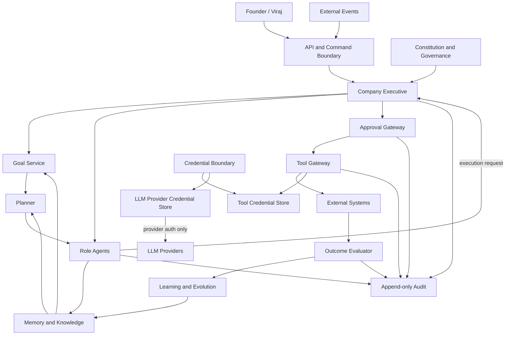
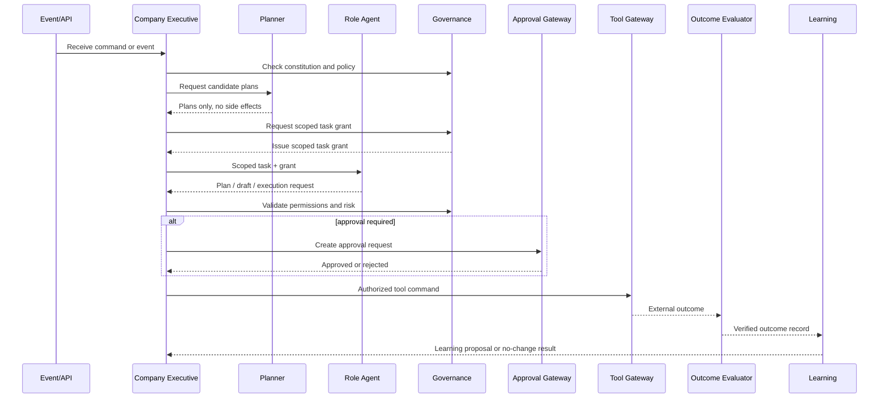
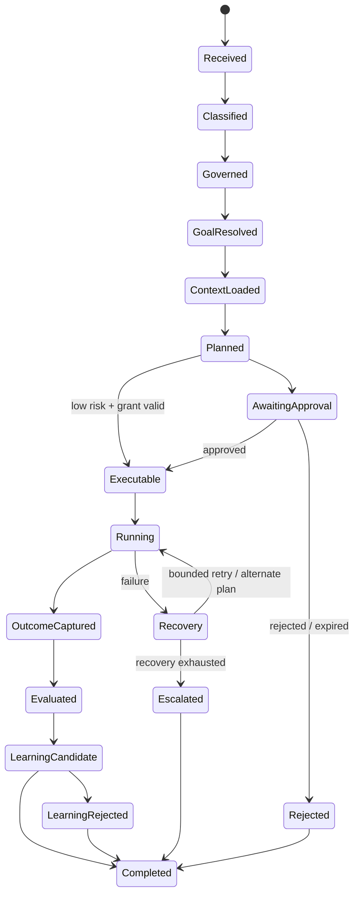
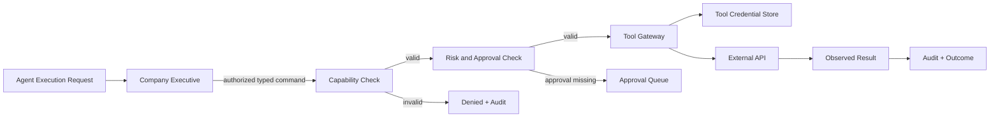

# Viraj Versenologies — Rust Company Intelligence Architecture

**Status:** Architecture specification — coding gate not yet opened  
**Implementation language:** Rust 2021+  
**Architecture style:** Modular monolith first, event-driven boundaries, ports-and-adapters  
**Primary rule:** Every capability has one owner of truth and one explicit authority boundary.

## 1. Purpose

Viraj Verse ke liye Rust mein ek long-running Company Intelligence Operating System banana hai. Ye prompt collection ya simple multi-agent chat application nahi hoga.

System ka kaam:

- Company goals ko manage karna
- Business events ko process karna
- Role-based agents ko bounded authority ke andar kaam dena
- Memory, procedures aur verified experience use karna
- External tools ko permission gateway se invoke karna
- Human approval ke bina high-impact action na lena
- Outcomes se controlled learning karna
- Evidence ke basis par autonomy earn karna

## 2. Non-goals

- Apna Transformer/LLM train karna
- Fine-tuning ko primary learning mechanism banana
- Har role ke liye separate model ya separate brain banana
- LLM ko source of truth, permission authority ya permanent memory banana
- Agent ko unrestricted shell/API/database access dena
- Reference `Brain_Mind` project ke code ko copy ya modify karna

## 3. Top-level architecture



## 4. Authority model

Authority ka matlab hai kisi state ya decision ko final form mein accept karne ka right. Capability ka matlab sirf calculation ya suggestion karna hai. Har module capability rakh sakta hai, lekin authority nahi.

| Authority | Single owner | Can do | Cannot do |
|---|---|---|---|
| Company constitution | Constitution authority | Immutable rules enforce; amendments only through signed founder-approved migration | Runtime learning se rules loosen nahi kar sakta |
| High-impact business approval | Viraj by default; named human only if constitution allows | Price, contract, refund, public commitment approve/reject | Agent ya LLM delegate nahi kar sakta |
| Company goals | Goal Authority / Goal Service | Goal lifecycle, priority, pause, resume and governed self-goal acceptance | Executive, agent ya LLM direct mutation nahi kar sakte |
| Role execution | Assigned role agent | Domain task plan/propose and prepare execution request within grant | Direct external side effect, dusre role ki authority ya policy mutate nahi kar sakta |
| Planning | Planner | Candidate plans and dependencies create | External side effect execute nahi kar sakta |
| Memory persistence | Memory service | Versioned records store/retrieve/archive with scope checks | Facts ko silently overwrite nahi kar sakta |
| Truth status | Knowledge authority | Evidence, confidence, provenance and validity state manage | Unsupported claim ko verified nahi bana sakta |
| Learning promotion | Learning service | Skill/policy/procedure update propose and validate | Constitution/permissions change nahi kar sakta |
| Tool side effects | Tool gateway | Authorized external action execute | Missing grant or applicable approval/policy par action nahi le sakta |
| Outcome truth | Outcome evaluator | Actual result record and score | Result ko execution se pehle invent nahi kar sakta |
| Audit history | Audit writer | Append trace records | Existing audit event edit/delete nahi kar sakta |
| LLM | LLM adapter | Language/reasoning candidate output | Authority, memory, permission ya approval nahi |

## 5. Canonical role registry

Ye registry implementation ke liye canonical hai. `Company Executive` central authority/runtime hai; ye specialist role agent nahi hai. `Orchestrator` alag authority ya state owner nahi hoga—ye Executive ke andar planning, routing aur scheduling capability/interface ka naam ho sakta hai.

### MVP specialist roles

1. Sales and Lead
2. Discovery and Proposal
3. Project Operations
4. Client Success and Communication

### Next expansion roles

5. Growth and Content
6. Social Media

### Future roles

7. Support
8. Finance/Admin
9. Research
10. Analytics

Quality/Governance independent business agent nahi hai; governance authority aur verification subsystem hai. New role registration Governance-controlled registry aur Executive coordination ke through hi hogi.

Role activation order roadmap mein defined hai, lekin koi role tab tak runtime mein registered nahi maana jayega jab tak uska profile, memory scope, tools, permissions, escalation rules aur tests approve na hon.

## 6. Authority flow



## 7. Core runtime loop



## 8. Separation of concerns

### Company Executive

System ka central coordinator hai. Ye goal, routing, scheduling, escalation aur state transition own karta hai. Ye direct database SQL, arbitrary HTTP ya raw LLM prompt execution nahi karega.

### Role agents

Sales, growth/content, social, discovery/proposal, client success, project operations, support, finance/admin jaise roles domain behavior provide karenge. Agent ko task grant, client scope, tool grant aur deadline ke bina kaam nahi milega.

### LLM capability

LLM sirf typed request se invoke hoga aur typed candidate response dega. LLM output ko validate, govern aur authorize karna runtime ka kaam hai.

### Memory and knowledge

Memory storage hai. Knowledge status, provenance aur confidence alag domain rules se manage honge. Retrieval kisi fact ko automatically true nahi banata.

### Learning

Learning outcome evidence se candidate skill, procedure, policy ya pattern propose karega. Promotion versioned aur reversible hogi.

### Tools

Tool gateway hi external side effect ka single door hai. Agent kabhi directly email, CRM, WhatsApp, social API, payment system ya filesystem mutate nahi karega.

## 9. State ownership rule

```text
One state field → One owning authority → One mutation path
```

Examples:

- `Goal.status` → Goal service
- `Task.status` → Executive runtime
- `Approval.status` → Approval gateway; human/policy only supplies the decision
- `Memory.lifecycle` → Knowledge authority
- `Skill.version` → Learning authority
- `Tool.execution_status` → Tool gateway
- `Outcome.result` → Outcome evaluator
- `AuditEvent` → Audit writer only

Read access broad ho sakta hai; write access explicit capability se hi milega.

## 10. Data flow rules

1. Commands intention represent karte hain.
2. Domain events completed state-transition facts represent karte hain; external inputs pehle observations/claims hote hain.
3. Agent result recommendation, draft ya execution request hota hai.
4. Tool result external observation hota hai.
5. Learning proposal direct truth nahi hota.
6. Approval decision human or configured approval authority ka record hota hai.
7. Audit event append-only hota hai.

## 11. Security and trust boundaries



Credentials agent memory, prompts ya event payloads mein store nahi honge. Credential boundary do separate least-privilege stores expose karegi: `Tool Credential Store` sirf Tool Gateway ko, aur `LLM Provider Credential Store` sirf provider-specific LLM adapters ko. Tool Gateway LLM credentials nahi padh sakta, aur LLM adapters tool/API credentials nahi padh sakte. Dono stores ke access, rotation, audit aur secret references independent honge.

## 12. Role Authority Catalogue

| Role | Owns | May propose/execute | Must escalate |
|---|---|---|---|
| Sales | Lead qualification and follow-up state | Research, CRM updates, routine follow-ups | Pricing, discount, commitment |
| Discovery/Proposal | Requirement and proposal drafts | Discovery summaries, scope drafts | Final quote, contract, delivery promise |
| Growth/Content | Campaign and research drafts | Research, content suggestions, experiments | Paid campaigns, brand-risk claims |
| Social Media | Content pipeline | Drafts, calendar, analytics reads | Public posting unless policy grants it |
| Client Success | Client communication state | Approved templates, summaries, feedback | New promise, refund, scope change |
| Project Operations | Internal delivery coordination | Tasks, milestones, status drafts | Technical commitment, final delivery |
| Support | Support ticket lifecycle | Triage, known fixes, response drafts | Data loss, production change, unknown bug |
| Finance/Admin | Invoice and payment workflow | Read/report, reminders if approved | Refund, bank/payment mutation, tax decision |
| Research | Deferred — profile pending activation | No runtime grant until role registration is approved | Any research execution outside an approved role profile |
| Analytics | Deferred — profile pending activation | No runtime grant until role registration is approved | Any analytics execution outside an approved role profile |

Research and Analytics rows are catalogue placeholders, not active runtime roles. Role ownership does not override governance, client isolation or founder approval.

## 13. Rust implementation principle

Rust compile-time types authority boundaries ko reinforce karenge, lekin compile-time type safety business approval ka replacement nahi hai. Runtime policy, persisted state, audit and human approval equally mandatory hain.

Implementation pehle modular monolith hoga. Services ko alag deploy karna future optimization ho sakta hai, initial design assumption nahi.

## 14. Coding gate

Coding tab start hogi jab ye documents approve/freeze hon:

- Master architecture
- Authority and contracts
- Rust workspace/module specification
- Implementation roadmap and verification plan

Architecture change ke liye versioned decision record required hoga. Code se architecture assumptions silently change nahi hongi.
