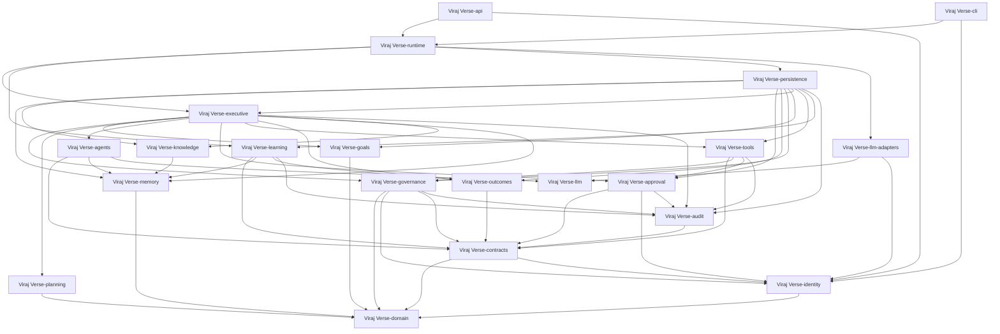
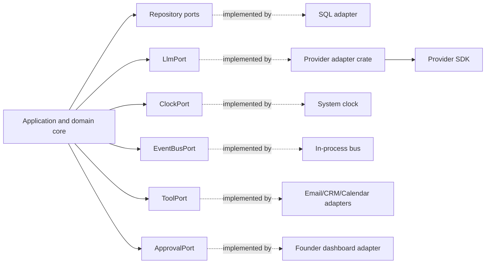
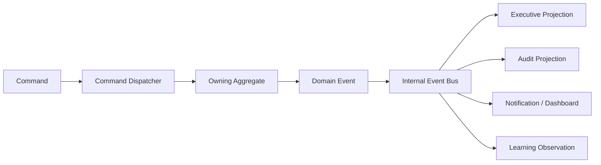
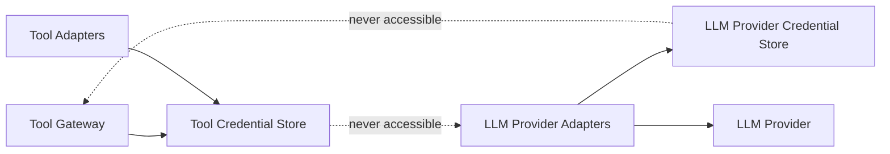

# Viraj Versenologies — Rust Workspace and Module Specification

**Status:** Pre-coding technical design  
**Deployment strategy:** Modular monolith with internal event boundaries  
**Future option:** Selected modules can become services after measured need

## 1. Workspace layout

```text
Viraj Verse-company-os/
├── Cargo.toml
├── crates/
│   ├── Viraj Verse-domain/
│   ├── Viraj Verse-identity/
│   ├── Viraj Verse-contracts/
│   ├── Viraj Verse-governance/
│   ├── Viraj Verse-executive/
│   ├── Viraj Verse-goals/
│   ├── Viraj Verse-planning/
│   ├── Viraj Verse-agents/
│   ├── Viraj Verse-memory/
│   ├── Viraj Verse-knowledge/
│   ├── Viraj Verse-learning/
│   ├── Viraj Verse-approval/
│   ├── Viraj Verse-tools/
│   ├── Viraj Verse-outcomes/
│   ├── Viraj Verse-audit/
│   ├── Viraj Verse-llm/
│   ├── Viraj Verse-llm-adapters/
│   ├── Viraj Verse-runtime/
│   ├── Viraj Verse-persistence/
│   ├── Viraj Verse-api/
│   └── Viraj Verse-cli/
├── migrations/
├── config/
├── docs/
└── tests/
```

## 2. Dependency direction



Dependency rules:

- **Core crates** (`Viraj Verse-domain`, `Viraj Verse-identity`, `Viraj Verse-contracts`) must not import database, HTTP, provider SDK or prompt code, and must not depend on any other Viraj Verse crate above them.
- **Capability/application crates** (governance, goals, planning, agents, memory, knowledge, learning, approval, tools, outcomes, audit, llm, executive) define their own ports and must not depend on `Viraj Verse-persistence`, `Viraj Verse-llm-adapters`, `Viraj Verse-runtime`, `Viraj Verse-api` or `Viraj Verse-cli`.
- **Adapter crates** (`Viraj Verse-persistence`, `Viraj Verse-llm-adapters`) sit in the outer ring. They may depend on any application crate whose ports they implement, but never on runtime, API or CLI.
- **`Viraj Verse-runtime`** is the composition root; only it, API and CLI wire adapters to ports.
- Executive reads memory/knowledge only through the purpose-bound, task-scoped Memory API; dependency does not grant raw client content access.
- The graph must stay acyclic; a CI check will enforce these rules once the workspace exists.

## 3. Crate responsibilities

### `Viraj Verse-domain`

Pure business entities, value objects, identifiers, lifecycle enums and invariant functions. No I/O.

Owns:

- `GoalId`, `TaskId`, `ClientId`, `ProjectId`, `AgentId`, `TraceId`
- Risk, confidence, lifecycle and execution state types
- Domain validation rules that do not require persistence

### `Viraj Verse-identity`

Authenticated founder, human approver, service, agent and external-source identities. It defines subject identity and authentication/authorization adapter ports; it does not decide business approval by itself.

### `Viraj Verse-contracts`

Commands, events, envelopes, capability grants and DTO schemas shared between modules. Contracts are versioned.

### `Viraj Verse-governance`

Constitution constraint loading, versioned Policy Registry, policy evaluation, risk classification, capability checks, agent registry and immutable rule enforcement. Runtime governance cannot amend the constitution.

### `Viraj Verse-executive`

Company-level coordination. It owns task routing, scheduling, state transitions, escalation and execution decisions.

### `Viraj Verse-goals`

Goal forest, goal dependencies, progress, priority and governed self-goal proposals.

### `Viraj Verse-planning`

Candidate plans, decomposition, case adaptation, dependency ordering and plan comparison. It cannot execute side effects.

### `Viraj Verse-agents`

Role implementations only. The agent registry and capability profile authority live in `Viraj Verse-governance`; agents use ports and do not own infrastructure clients or self-register.

### `Viraj Verse-memory`

Working memory, experience memory, client namespace access, retrieval and memory write requests.

### `Viraj Verse-knowledge`

Provenance, evidence, confidence, contradiction, stale detection and truth lifecycle. It controls whether a memory item is candidate, verified or stale; it does not own physical memory persistence.

### `Viraj Verse-learning`

Outcome-to-learning analysis, pattern abstraction, procedure revision, skill promotion and rollback proposals.

### `Viraj Verse-approval`

Approval request lifecycle, human/policy decision recording, expiry and exact action binding. It emits approval audit events; the audit service owns append-only audit persistence.

### `Viraj Verse-tools`

Capability-checked tool execution and adapters. This is the only crate allowed to create external side effects.

### `Viraj Verse-outcomes`

Result observation, success criteria evaluation, prediction comparison, calibration and outcome records.

### `Viraj Verse-audit`

Append-only audit event creation and query interfaces. No update/delete API for historical records.

### `Viraj Verse-llm`

Provider-neutral `LlmPort`, request/response contracts, structured output validation and cost/latency telemetry. This crate contains no provider SDK, provider credential handling or provider-specific business logic.

### `Viraj Verse-llm-adapters`

Provider-specific implementations of `LlmPort`. Each adapter owns provider SDKs, authentication transport, model mapping, rate-limit normalization and provider errors. Credentials are accessed through the LLM Provider Credential Store only and never exposed to agents, prompts or persisted contracts.

### `Viraj Verse-runtime`

Composition root, event loop, command dispatch, transaction boundaries, retries and shutdown behavior.

### `Viraj Verse-persistence`

Database repositories, migrations, transactions and serialization implementations. It implements ports defined by domain/application crates.

### `Viraj Verse-api` and `Viraj Verse-cli`

External HTTP/CLI interfaces. They translate input into commands; they do not implement business authority.

## 4. Ports and adapters



Ports define capabilities. Adapters contain provider-specific details. Swapping a provider must not change executive or agent authority logic.

## 5. Domain aggregate ownership

| Aggregate | Owning crate | Mutation entry point |
|---|---|---|
| CompanyState (excluding GoalTree) | Executive | Executive command handler |
| GoalTree | Goals | Goal command handler |
| Task | Executive | Task state machine |
| TaskGrant | Governance | Grant issuance, activation, expiry and revocation workflow |
| AgentProfile | Governance | Authenticated registration workflow |
| MemoryRecord storage | Memory | Versioned scoped memory command |
| MemoryRecord truth status | Knowledge | Evidence-backed lifecycle command |
| SkillVersion | Learning | Promotion workflow |
| ApprovalRequest | Approval | Approval command handler |
| ToolExecution | Tools | Tool gateway |
| OutcomeRecord | Outcomes | Outcome evaluator |
| AuditEvent | Audit | Append writer |

## 6. Important Rust type boundaries

Conceptual types:

```rust
pub enum ActorCategory {
    Founder,
    NamedHumanApprover,
    CompanyExecutive,
    RoleAgent,
    SystemService,
    ExternalSource,
}

pub struct ActorIdentity {
    pub subject_id: SubjectId,
    pub actor_category: ActorCategory,
    pub credential_ref: CredentialRef,
    pub provider_ref: AuthProviderRef,
    pub authenticated_at: chrono::DateTime<chrono::Utc>,
    pub session_ref: Option<SessionRef>,
}

pub struct TraceContext {
    pub trace_id: TraceId,
    pub correlation_id: CorrelationId,
    pub causation_id: Option<CausationId>,
    pub actor: ActorIdentity,
    pub recorded_at: chrono::DateTime<chrono::Utc>,
    pub schema_version: SchemaVersion,
}

pub struct ClientScope(pub uuid::Uuid);
pub struct ProjectScope(pub uuid::Uuid);
pub struct TenantScope(pub uuid::Uuid);
pub struct TaskGrant {
    pub grant_id: GrantId,
    pub task_id: TaskId,
    pub agent_id: AgentId,
    pub subject_id: SubjectId,
    pub role: AgentRole,
    pub allowed_capabilities: Vec<Capability>,
    pub client_scope: Option<ClientScope>,
    pub project_scope: Option<ProjectScope>,
    pub tenant_scope: TenantScope,
    pub risk_class: RiskClass,
    pub approval_reference: Option<ApprovalRef>,
    pub action_digest: ActionDigest,
    pub policy_version: PolicyVersion,
    pub grant_status: GrantStatus,
    pub issued_at: chrono::DateTime<chrono::Utc>,
    pub expires_at: chrono::DateTime<chrono::Utc>,
    pub max_calls: u32,
    pub issued_by: ActorIdentity,
    pub audit_trace_id: TraceId,
    pub revocation_reference: Option<RevocationRef>,
}
```

This is the same canonical schema defined in `Viraj Verse_AUTHORITY_BOUNDARIES_AND_CONTRACTS.md`; no second reduced `TaskGrant` shape is allowed. Grant-to-action binding rules (one digest per side-effecting grant, read-scope digest for R0 grants) are defined in that document's §4. The exact Rust dependency choices remain open until the infrastructure decision record, but these semantic boundaries are fixed.

## 7. Event-driven internal flow



Commands are validated before aggregate mutation. Events are emitted only after successful state persistence. Side effects consume authorized commands and produce result events.

## 8. Persistence boundary

Initial persistence may use one relational database with separate tables/namespaces:

- `goals`
- `tasks`
- `task_grants`
- `agent_profiles`
- `memory_records`
- `knowledge_evidence`
- `skill_versions`
- `policy_versions`
- `approval_requests`
- `tool_executions`
- `outcomes`
- `audit_events`
- `outbox_events`
- `idempotency_reservations`

All mutations require optimistic version checks. External dispatch uses a transactional outbox. Every side-effect command atomically reserves a unique `(tenant_scope, tool_name, idempotency_key)` before dispatch; the same key can have only one reservation owner. A concurrent duplicate is serialized behind the first reservation or rejected with the existing execution reference.

`tenant_scope` company/organization boundary hai, client nahi. Current Viraj Verse deployment mein ye Viraj Verse company boundary represent karega; `client_scope` aur `project_scope` narrower authorization scopes hain. Same key + same canonical `action_digest` existing execution reference return karega. Same key + different digest `IdempotencyConflict` reject karega; old execution ko new payload ka result nahi maana jayega.

Database commit and event publication recover through the outbox. Outbox delivery is at-least-once, so adapters must remain idempotent and every delivery must reconcile the stored execution reservation.

## 9. Runtime concurrency model

- Tokio runtime may run independent tasks concurrently.
- Each aggregate mutation is serialized by transaction/version check.
- Client-scoped tasks may run in parallel if grants do not conflict.
- Same task/tool operation cannot be executed concurrently merely because it has an idempotency key; the key must be atomically reserved by a unique database constraint.
- Concurrent duplicate attempts wait for or return the original reservation; they never independently call the external provider.
- Tool calls have timeout, retry and circuit-breaker policy.
- `UnknownExternalState` blocks blind retry until provider status reconciliation completes.
- Shutdown must stop new work, finish safe in-flight work, persist state and release leases.

## 10. LLM provider boundary

`LlmPort` returns a provider-neutral structured response. The provider adapter owns:

- Authentication
- Provider request format
- Model selection
- Rate limits
- Token accounting
- Provider errors

The adapter does not own:

- Company truth
- Approval
- Agent permissions
- Skill promotion
- External business side effects

### Credential boundary

Tool credentials and LLM provider credentials are separate secret domains:



`Tool Credential Store` contains CRM, email, calendar, messaging, payment and other business-tool credentials. `LLM Provider Credential Store` contains only LLM provider credentials. Each store has separate runtime identity, access policy, rotation, audit trail and secret references. `Viraj Verse-llm` remains provider-neutral; only `Viraj Verse-llm-adapters` can request LLM provider credentials.

## 11. Tool adapter boundary

Every adapter implements:

```text
validate_input()
check_capability()
check_scope()
reserve_idempotency_atomically()
execute()
normalize_result()
emit_audit()
```

Adapters must return `Succeeded`, `Failed`, `TimedOut`, `Rejected`, `IdempotencyConflict`, or `UnknownExternalState`. `UnknownExternalState` requires reconciliation before retry.

The atomic reservation is performed through the persistence port inside the Tool Gateway transaction; an adapter cannot implement idempotency with an in-memory map alone.

## 12. Configuration boundary

Configuration categories:

- Immutable code invariants
- Versioned company policy
- Environment configuration
- Secret references
- Runtime feature flags
- Learned procedures and skills

Secrets are never configuration values copied into agent prompts or persisted events.

## 13. Observability

Every command, event, LLM call, tool call, approval and learning update carries the canonical `TraceContext` defined in `Viraj Verse_AUTHORITY_BOUNDARIES_AND_CONTRACTS.md`:

- `trace_id` — mandatory for every operation
- `correlation_id` — mandatory for every workflow; generated at intake if absent
- `causation_id` — field always present; `None` only for a root command/external observation, otherwise parent operation reference mandatory
- `actor: ActorIdentity` — mandatory for every operation
- `recorded_at` — mandatory timestamp
- `schema_version` — mandatory for every serialized contract

Operation-specific timestamps such as `created_at`, `occurred_at`, `requested_at` and `completed_at` may be added, but they do not replace `TraceContext.recorded_at`. Derived records inherit `correlation_id` and reference their parent through `causation_id`.

Metrics:

- queue depth
- task latency
- approval wait time
- tool error rate
- retry count
- LLM cost
- memory retrieval hit/usefulness
- learning promotion rate
- autonomy regression rate

## 14. Audit integrity and retention

Audit integrity application convention se nahi, database and operational permissions se enforce hogi:

- Audit writer ke paas append-only `INSERT` permission hogi.
- Normal runtime identities ke paas audit rows par `UPDATE` ya `DELETE` permission nahi hogi.
- Audit query/read access separate role aur least-privilege policy se protected hoga.
- Historical audit storage append-only object/storage policy, immutable backups ya equivalent control se protected hoga.
- Har event mein canonical payload digest, previous-event digest/chain reference, actor, policy version aur trace IDs honge.
- Tamper-evidence verification scheduled integrity checks se run hogi.
- Retention policy, legal hold aur client-data redaction policy documented aur versioned hongi.
- Retention expiry par physical deletion sirf separately authorized maintenance identity karegi, with a signed audit record; normal runtime kabhi historical events delete nahi karega.

## 15. Testing architecture

| Level | Verifies |
|---|---|
| Pure unit | Domain invariants and state transitions |
| Contract | Command/event serialization and version compatibility |
| Authority | Forbidden writes, scope violations and approval bypass prevention |
| Repository | Persistence versioning, transactions and migrations |
| Adapter | External provider normalization and error classification |
| Workflow | End-to-end business loops with fake tools |
| Property-based | State machine invariants, idempotency and retry behavior |
| Security | Secret isolation and client namespace boundaries |
| Recovery | Crash/restart, outbox replay and unknown external state |

## 16. Explicitly deferred decisions

Ye decisions architecture freeze se pehle record honge:

- Exact relational database
- Vector/search implementation
- API framework
- Authentication provider
- Queue technology, if needed
- LLM provider(s)
- External CRM/email/calendar/social integrations
- Deployment topology

In decisions ko code mein accidentally choose nahi kiya jayega; har choice ADR ke through freeze hogi.
